## Complete Microsoft 365 Environment Diagram
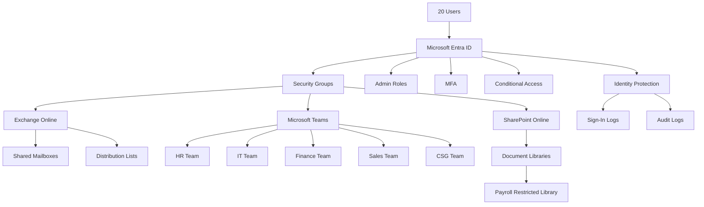


## 1. High-Level Microsoft 365 Architecture

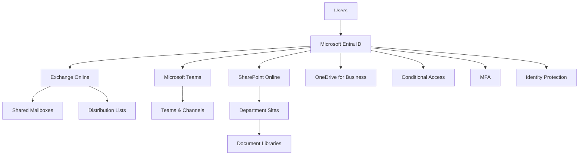
## 2. User Onboarding Workflow
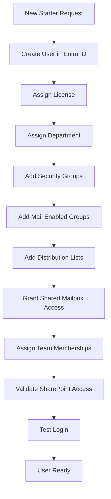

## 3. User Offboarding Workflow


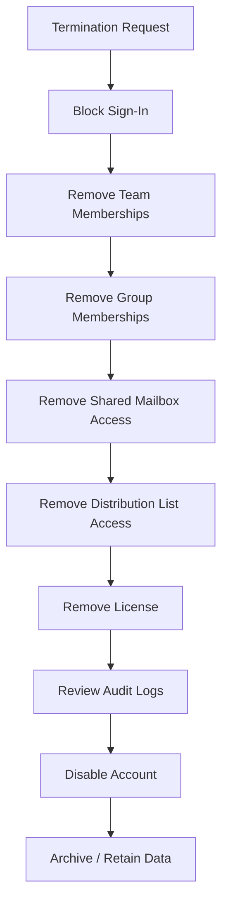
## 4. Auditor Access Request Workflow

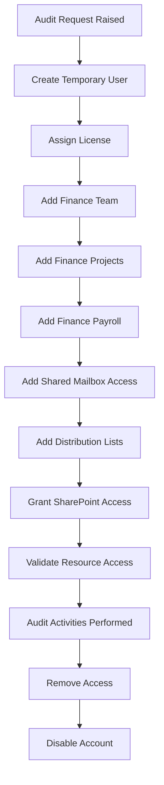

## 5. Finance Department Access Model
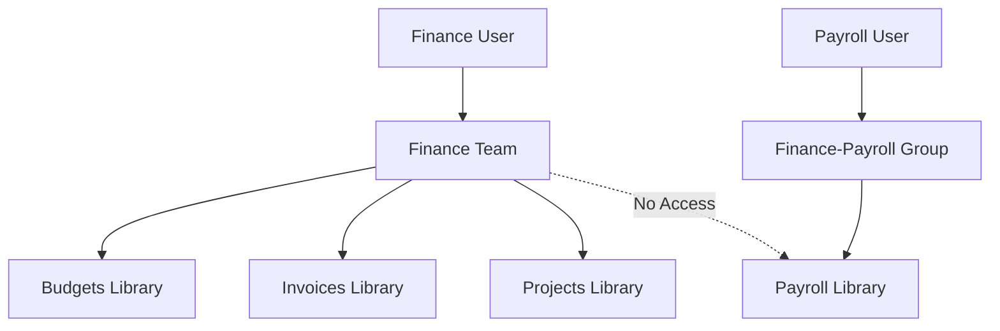


## 6. Teams and SharePoint Relationship
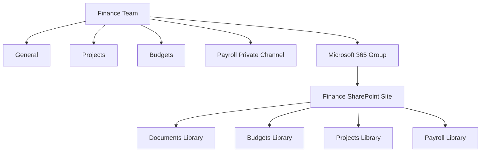

## 7. Shared Mailbox Access Model
```mermaid {preview="true"}
flowchart LR

    FinanceUser[Finance Users]

    FinanceUser --> MailGroup[Finance-Mailbox Group]

    MailGroup --> SharedMailbox[finance@ Shared Mailbox]

    SharedMailbox --> ReadMail[Read Mail]

    SharedMailbox --> SendAs[Send As]

    SharedMailbox --> SharedCalendar[Shared Calendar]
```


## 8. RBAC Model

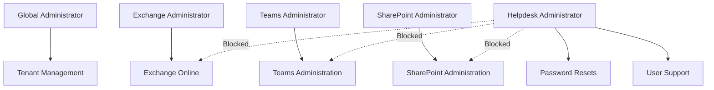

## 9. Conditional Access Workflow
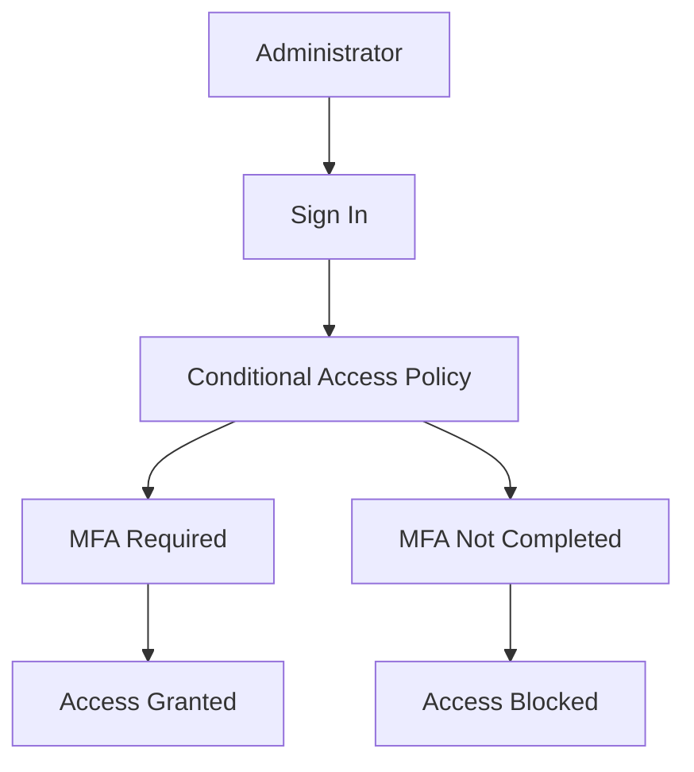

## 10. Identity Protection Investigation
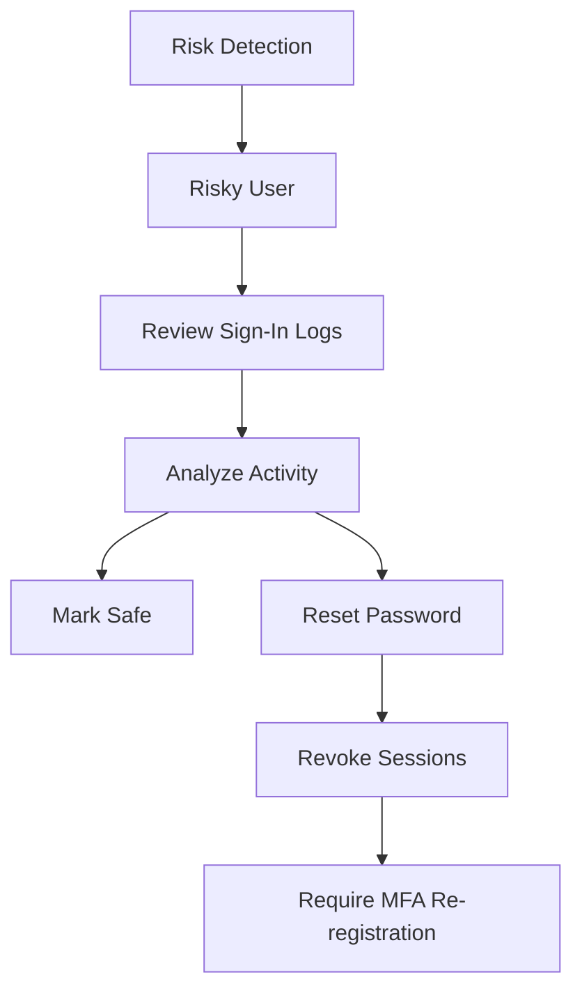

## 11. Troubleshooting Methodology
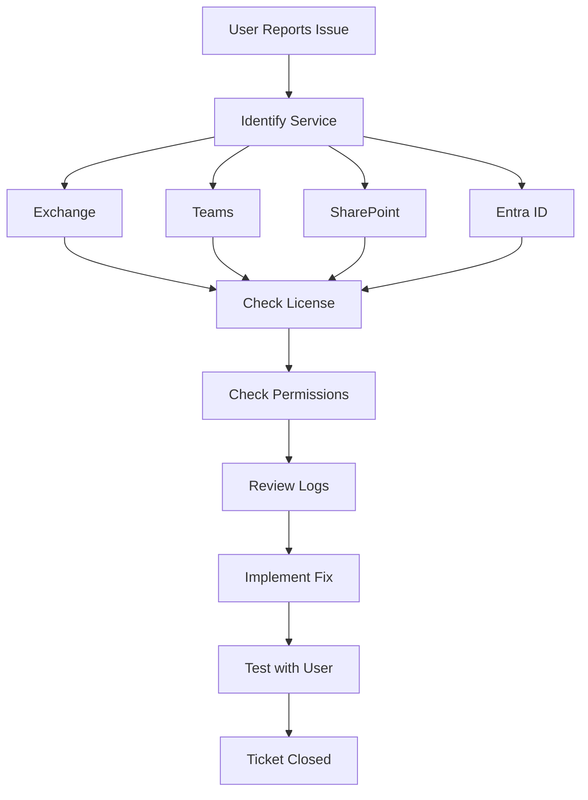
## 

## 

## 

## 


