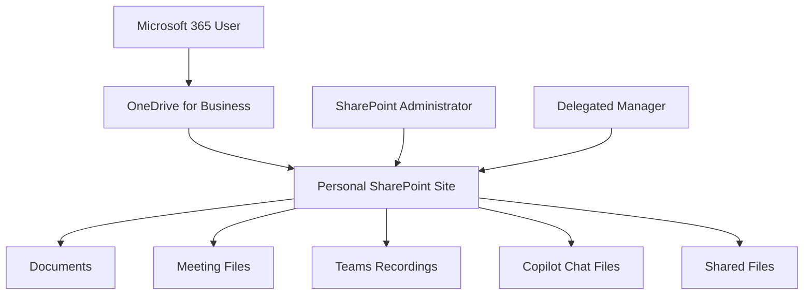
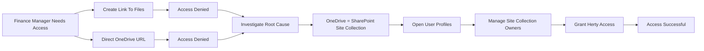
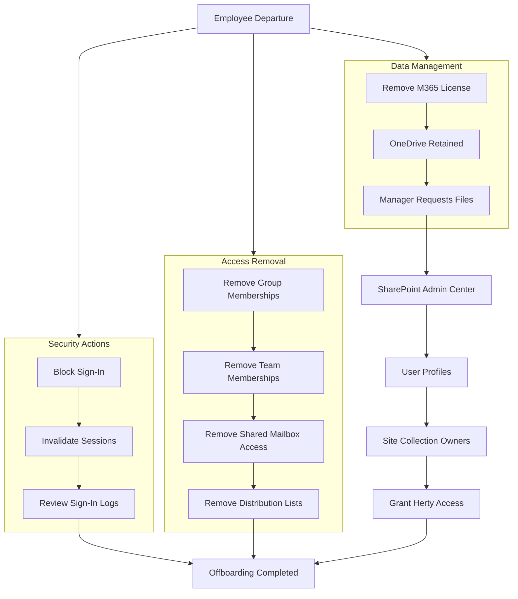
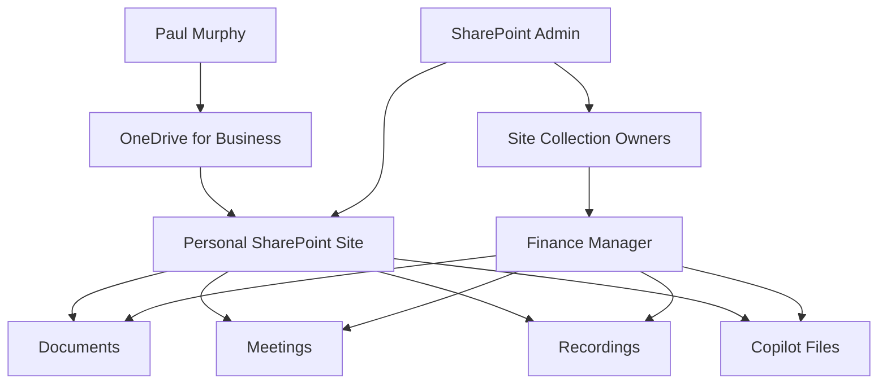
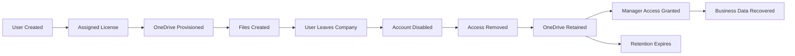

# OneDrive Administration & User Data Management

## Overview

Implemented and administered OneDrive for Business as part of a Microsoft 365 enterprise environment.

This phase focused on understanding how OneDrive integrates with SharePoint Online, file retention, employee offboarding processes, manager access delegation, and business data recovery.

---
## OneDrive Architecture


## OneDrive Provisioning

Validated automatic OneDrive provisioning for licensed Microsoft 365 users.

Verified:

- Personal OneDrive sites
- Document storage
- User file synchronisation
- Browser access
- Integration with Microsoft Teams and Microsoft 365

---

## Understanding OneDrive Architecture

OneDrive for Business is backed by a personal SharePoint Online site.

```text
User Account
     ↓
OneDrive
     ↓
Personal SharePoint Site
```

Example:

```text
Paul Murphy
     ↓
OneDrive
     ↓
Personal SharePoint Site
```

This understanding was essential when troubleshooting delegated access to user data.

---

## OneDrive File Management

Created and tested:

- Word Documents
- Excel Workbooks
- PowerPoint Presentations
- Teams Meeting Recordings
- Microsoft Copilot Chat Files

Validated:

- Uploads
- Downloads
- Synchronisation
- Version History
- File Recovery

---
## OneDrive Architecture & Delegation Model


## Employee Offboarding Scenario

### Business Requirement

A temporary Finance Auditor (Paul Murphy) completed an audit engagement and required offboarding.

### Actions Performed

- Removed Microsoft Teams membership
- Removed Finance Team access
- Removed Finance Payroll access
- Removed SharePoint access
- Removed Distribution Lists
- Removed Shared Mailbox access
- Removed Microsoft 365 licence
- Disabled account sign-in

### Validation

Verified that:

- Finance resources became inaccessible
- SharePoint access was revoked
- Teams membership was removed
- Outlook access was withdrawn
- User sign-in was blocked

---

## OneDrive Data Retention Testing

Following user offboarding:

- OneDrive data remained available
- Files remained stored
- Business information was preserved
- Administrative access was retained

Observed behaviour:

```text
Account Disabled
        ≠
Data Deleted
```

This demonstrated Microsoft's retention model and business continuity capabilities.

---

## Manager Access Delegation

### Objective

Grant Finance Manager access to OneDrive data belonging to a departed employee.

Manager:

```text
Herty Yank (FIN)
```

Departed User:

```text
Paul Murphy (FIN)
```

---

## Initial Troubleshooting

Initial attempts included:

- Creating file access links
- Sharing OneDrive content
- Sending delegated access URLs

Result:

```text
Access Denied
You can't access this list
```

These methods did not provide sufficient permissions to manage the personal OneDrive site.

---

## Root Cause

OneDrive permissions were being treated as file-sharing permissions rather than site-administration permissions.

Microsoft OneDrive for Business operates using a personal SharePoint site collection.

Site-level administration was required.

---

## Resolution

Navigated to:

```text
SharePoint Admin Center
→ More Features
→ User Profiles
→ Manage User Profiles
→ Manage Site Collection Owners
```

Assigned:

```text
Herty Yank (FIN)
```

as:

```text
Site Collection Administrator
```

for Paul's personal SharePoint site.

---

## Outcome

Successfully granted:

- Full administrative access
- File visibility
- Data retrieval capability
- Business continuity access

The Finance Manager was able to review files after user departure.

---

## Troubleshooting Lessons Learned

### Attempt

```text
Create Link To Files
```

Result:

```text
Access Denied
```

---

### Attempt

```text
Direct URL Access
```

Result:

```text
Access Denied
```

---

### Solution

```text
Grant Site Collection Administrator Rights
```

Result:

```text
Success
```

---

## Key Learning Outcomes

- OneDrive for Business is backed by SharePoint Online.
- User file access differs from site administration.
- Site Collection Administrator permissions provide management capabilities over personal sites.
- User offboarding requires consideration of data ownership and retention.
- Business files remain available after account disablement.
- SharePoint administration skills are essential for advanced OneDrive management.

## OneDrive Offboarding Process



## OneDrive Architecture & Delegation Model

## Visual Enterprise Lifecycle Diagram


