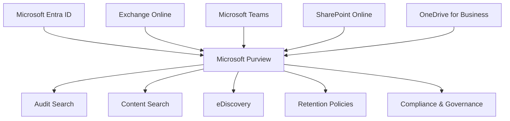
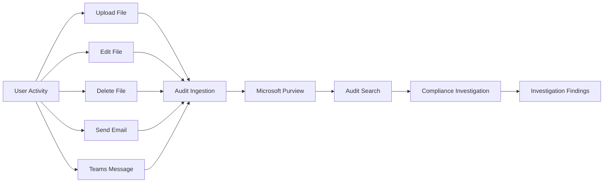

# Microsoft Purview - Compliance, Auditing & Governance

## Overview

Implemented and explored Microsoft Purview to develop practical experience with Microsoft 365 compliance, auditing, content discovery, retention, investigations and governance capabilities.

The objective was to understand how Microsoft 365 workloads including Exchange Online, SharePoint Online, OneDrive for Business, Microsoft Teams and Microsoft Entra ID integrate with Purview to provide centralized auditing and compliance functionality.

---

## Microsoft Purview Exploration

Accessed and reviewed the following Microsoft Purview solutions:

- Audit
- eDiscovery
- Content Search
- Data Lifecycle Management
- Retention Policies
- Role Based Access Controls
- Compliance Administration

---

## Audit Configuration

During initial testing, Microsoft Purview auditing had not previously been enabled within the tenant.

After enabling auditing, activity was generated across multiple Microsoft 365 workloads to build a known data set for investigation and validation.

Activities generated included:

### Microsoft Entra ID

- User administration
- Group membership changes
- Role assignments
- Password reset requests
- Administrative actions

### Exchange Online

- Email send
- Email forward
- Email delete
- Shared mailbox access

### OneDrive for Business

- File upload
- File creation
- File modification
- File deletion
- File restoration
- Access delegation

### SharePoint Online

- Document library activity
- File upload
- File rename
- File deletion
- Recycle Bin activity
- Permission changes

### Microsoft Teams

- Team creation
- Channel creation
- Channel messaging
- File uploads
- Collaboration activities

---

## Audit Investigation Testing

Created controlled audit scenarios to simulate compliance and investigation workflows.

### Example Scenario

Created:

```text
Payroll-2027.xlsx
```

Actions performed:

- Upload
- Rename
- Edit
- Delete
- Restore

Validation data collected:

```text
Created By:
Herty Yankson (FIN)

Deleted By:
Alpha Botchway (HR)

Location:
Finance Team Payroll Library
```

This provided a known activity trail for later audit validation.

---

## Microsoft Teams Investigation Scenario

Created:

```text
Audit Testing Channel
```

Activities performed:

- Posted messages
- Uploaded documents
- Shared files
- Generated collaboration activity

Purpose:

To create audit events across Teams and SharePoint Online workloads.

---

## eDiscovery & Content Search Investigation

Explored:

```text
Purview
→ eDiscovery
→ Content Search
```

Attempted searches across:

- Exchange Online
- SharePoint Online
- OneDrive for Business
- Microsoft Teams

---

## Troubleshooting Findings

### Audit Searches Returning Zero Results

Audit jobs completed successfully but returned:

```text
0 Results
```

Investigation identified likely causes:

- Auditing was enabled after earlier Microsoft 365 activities had already taken place.
- Audit data ingestion requires time before becoming searchable.
- Newly generated activities may take time to appear within Purview searches.

### Learning Outcome

An audit search completing successfully does not necessarily indicate audit records are immediately available.

Administrators should allow sufficient time for audit ingestion before conducting investigations.

---

## eDiscovery Permission Investigation

Encountered:

```text
Missing required permissions to view case.
```

and

```text
You are not a member of the Content Search case.
```

### Discovery

Microsoft Purview uses a dedicated role and permission model.

Holding the Global Administrator role alone does not automatically provide access to:

- eDiscovery Cases
- Content Search Cases
- Compliance Investigations

### Learning Outcome

Purview permissions must be assigned separately through compliance role groups and case memberships.

---

## Compliance Administration Skills Developed

### Auditing

- Audit Search
- Audit Investigation
- Activity Tracking
- User Action Validation

### eDiscovery

- Case Management Concepts
- Content Discovery
- Search Permissions
- Compliance Roles

### Governance

- Compliance Administration
- Data Investigation
- Information Governance Concepts
- Retention Concepts

### Troubleshooting

- Audit Data Ingestion Validation
- Compliance Permission Troubleshooting
- eDiscovery Access Resolution
- Purview Configuration Investigation

---

## Key Learning Outcomes

- Microsoft Purview provides centralized auditing across Microsoft 365 services.
- Audit events require ingestion time before becoming available for investigation.
- OneDrive, SharePoint, Teams and Exchange all contribute audit records to Purview.
- eDiscovery and Content Search use dedicated compliance permissions.
- Compliance administration is separate from traditional Microsoft 365 administration.
- Effective investigations require known audit activity and validation scenarios.

---

## Next Objectives

- Validate successful audit record ingestion.
- Perform Exchange Online audit investigations.
- Perform SharePoint and OneDrive audit searches.
- Configure Retention Policies.
- Configure Retention Labels.
- Explore eDiscovery investigations.
- Implement Data Lifecycle Management controls.


- 






